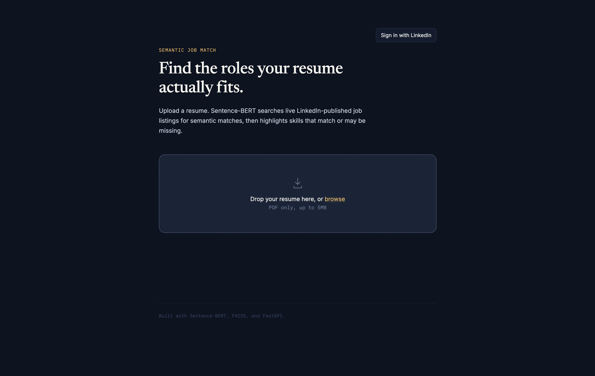
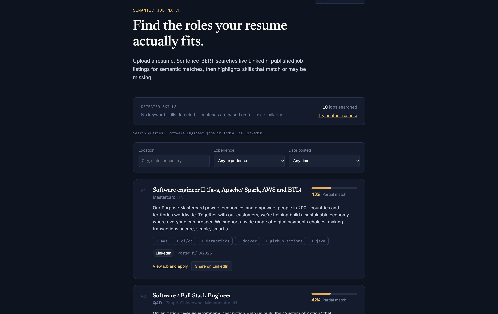
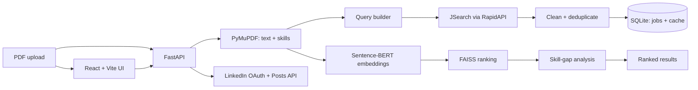

# Semantic Job Match

Upload a resume. Get ranked, LinkedIn-published job matches with explainable skill gaps.

> Independent project. Not affiliated with or endorsed by LinkedIn.


## Table of Contents

- [Demo](#demo)
- [Project Goal](#project-goal)
- [Problem Statement](#problem-statement)
- [What It Does](#what-it-does)
- [Features](#features)
- [How It Works](#how-it-works)
- [Architecture](#architecture)
- [Tech Stack](#tech-stack)
- [Quick Start](#quick-start)
- [Environment Variables](#environment-variables)
- [API Documentation](#api-documentation)
- [Project Structure](#project-structure)
- [Example Output](#example-output)
- [Current Status](#current-status)
- [Milestones](#milestones)
- [Roadmap](#roadmap)
- [Known Limitations](#known-limitations)
- [Data and Privacy](#data-and-privacy)
- [Deploying to Render](#deploying-to-render)
- [Contributing](#contributing)
- [License](#license)
- [Connect](#connect)

## Demo

🚧 **Live demo coming soon.**




## Project Goal

Help a job seeker go from a PDF resume to a short, ranked list of relevant, live job listings.

Each match shows:

- Why it fits
- Matched skills
- Missing skills
- Apply link
- Salary and posting date, when available

## Problem Statement

Most job boards rely on keyword search.

A resume that says **“built dashboards in Power BI”** may not match a posting that asks for **“data visualization with BI tools”**, even though the skills are similar.

Job seekers then scroll through hundreds of listings without a quick way to understand:

- Which jobs actually fit their profile
- Which skills they are missing
- Which roles are worth applying to

Semantic matching compares meaning rather than exact words. Skill-gap analysis turns each result into a clear next step.

## What It Does

1. You upload a PDF resume.
2. The app extracts resume text and skills.
3. It creates role and location-based search queries.
4. It fetches live listings from **JSearch through RapidAPI**.
5. It keeps listings identified by JSearch as published by LinkedIn.
6. It cleans descriptions and removes duplicate jobs.
7. It ranks jobs using Sentence-BERT embeddings and FAISS.
8. It shows matched skills, missing skills, apply links, salary, and posting date.
9. Optionally, you can sign in with LinkedIn and share a selected match after reviewing a preview.

> Job data comes from JSearch through RapidAPI, not from LinkedIn’s Jobs API.  
> The app does not scrape `linkedin.com` or use unofficial LinkedIn endpoints.

## Features

- **Semantic ranking** — Sentence-BERT (`all-MiniLM-L6-v2`) embeddings with FAISS `IndexFlatIP`
- **Live listings** — up to three role/location queries per resume
- **Clean data** — HTML stripped and duplicates removed
- **Skill insights** — matched and missing skills for every job
- **Filters** — location, experience level, and posting date
- **Caching** — JSearch responses cached in SQLite for 24 hours
- **LinkedIn sign-in** — OpenID Connect with encrypted server-side token storage
- **Optional sharing** — publish a match only after preview and confirmation
- **Privacy by design** — resumes are processed in memory and never written to disk
- **Tests and CI** — mocked tests for fetching, search, OAuth, and services

## How It Works

```text
Resume PDF
→ Extract text and skills
→ Build role/location queries
→ Fetch LinkedIn-published jobs through JSearch
→ Clean and deduplicate listings
→ Store jobs in SQLite
→ Create Sentence-BERT embeddings
→ Rank jobs using FAISS
→ Analyze skill gaps
→ Return ranked results in the React UI
```

The API reads up to three pages from the uploaded PDF, derives up to three role queries, and returns up to ten ranked matches.

The score measures **text similarity**. It is not a probability of being hired.

## Architecture



## Tech Stack

| Layer | Technology |
|---|---|
| Backend | Python 3.11, FastAPI, Pydantic |
| Resume parsing | PyMuPDF |
| Embeddings | Sentence-Transformers, `all-MiniLM-L6-v2`, 384-dimensional |
| Vector search | FAISS, in-memory `IndexFlatIP` |
| Job data | JSearch through RapidAPI |
| Storage | SQLite |
| Auth and sharing | LinkedIn OIDC, OAuth 2.0, Posts API |
| Frontend | React, Vite, CSS Modules |
| Testing and CI | pytest, ruff, GitHub Actions |
| Deployment | Render |

## Quick Start

### Requirements

- Python 3.11
- Node.js 18+
- RapidAPI key with access to JSearch
- Optional: LinkedIn developer app for sign-in and sharing

### Configure the backend

```bash
git clone [https://github.com/vaibhav9014/Linkedin-Semantic-Job-Search.git](https://github.com/vaibhav9014/Linkedin-Semantic-Job-Search.git)
cd Linkedin-Semantic-Job-Search

cp .env.example backend/.env
```

Generate the required secrets:

```bash
python -c "import secrets; print(secrets.token_urlsafe(48))"
```

```bash
python -c "import base64, secrets; print(base64.urlsafe_b64encode(secrets.token_bytes(32)).decode())"
```

Add the generated values to `backend/.env`:

```env
APP_SECRET_KEY=your_generated_secret
OAUTH_ENCRYPTION_KEY=your_generated_fernet_key
JSEARCH_API_KEY=your_rapidapi_key
```

For LinkedIn sign-in, also add:

```env
LINKEDIN_CLIENT_ID=your_linkedin_client_id
LINKEDIN_CLIENT_SECRET=your_linkedin_client_secret
LINKEDIN_REDIRECT_URI=http://localhost:8000/api/auth/linkedin/callback
```

In the LinkedIn Developer Portal, add this authorized redirect URL:

```text
http://localhost:8000/api/auth/linkedin/callback
```

### Start the backend

```bash
cd backend
python3.11 -m venv .venv
source .venv/bin/activate
pip install -r requirements.txt

uvicorn api.main:app --reload --port 8000
```

On first start, Sentence-Transformers downloads the model and the API creates the SQLite database.

Check:

```text
http://localhost:8000/api/health
```

### Start the frontend

Open a new terminal:

```bash
cd frontend
npm install
npm run dev
```

Open:

```text
http://localhost:5173
```

The frontend calls the backend at:

```text
http://localhost:8000/api
```

You can override this using `VITE_API_BASE_URL` in `frontend/.env`.

### Run tests

Fast test run without downloading the embedding model:

```bash
cd backend
pytest tests/ -v -k "not normalized_vector"
```

Full test run:

```bash
pytest tests/ -v
```

## Environment Variables

Copy `.env.example` to `backend/.env`.

Never commit real secrets. Never put backend secrets in frontend variables—anything prefixed with `VITE_` is public.

| Variable | Required | Example / Default | Purpose |
|---|---:|---|---|
| `JSEARCH_API_KEY` | Yes | `your_rapidapi_key` | RapidAPI key for JSearch |
| `JSEARCH_BASE_URL` | Yes | `https://jsearch.p.rapidapi.com/search-v2` | JSearch endpoint |
| `JSEARCH_AUTH_HEADER` | Yes | `x-rapidapi-key` | Header carrying the API key |
| `JSEARCH_COUNTRY` | Yes | `in` | Country code for job results |
| `JSEARCH_DATE_POSTED` | No | `all` | `all`, `today`, `3days`, `week`, or `month` |
| `JSEARCH_DEFAULT_LOCATION` | No | `India` | Used when no location is found in the resume |
| `JSEARCH_CACHE_TTL_SECONDS` | No | `86400` | Cache duration for JSearch responses |
| `JSEARCH_MAX_RETRIES` | No | `2` | Retries for 429 and 5xx errors |
| `LINKEDIN_CLIENT_ID` | For sign-in | `your_linkedin_client_id` | LinkedIn app client ID |
| `LINKEDIN_CLIENT_SECRET` | For sign-in | `your_linkedin_client_secret` | LinkedIn app secret, server-only |
| `LINKEDIN_REDIRECT_URI` | For sign-in | `http://localhost:8000/api/auth/linkedin/callback` | Must match LinkedIn Developer Portal |
| `LINKEDIN_API_VERSION` | For sharing | `202610` | LinkedIn Posts API version |
| `APP_SECRET_KEY` | Yes | Generated secret | Signs session and state cookies |
| `OAUTH_ENCRYPTION_KEY` | Yes | Generated Fernet key | Encrypts stored OAuth data |
| `FRONTEND_URL` | Yes | `http://localhost:5173` | Redirect target after sign-in |
| `CORS_ORIGINS` | Yes | `["http://localhost:5173"]` | Allowed frontend origins |
| `AUTH_COOKIE_SECURE` | No | `false` locally, `true` in production | HTTPS-only cookies |
| `AUTH_COOKIE_SAMESITE` | No | `lax` | Cookie SameSite policy |
| `JOBS_DB_PATH` | No | `data/jobs.sqlite3` | SQLite database location |

> Keep `OAUTH_ENCRYPTION_KEY` safe and backed up separately from the database. If it is lost or changed, stored OAuth data becomes unreadable.

## API Documentation

Base URL:

```text
http://localhost:8000/api
```

Interactive API docs:

```text
http://localhost:8000/docs
```

| Method | Endpoint | Purpose |
|---|---|---|
| `GET` | `/health` | API, model, and job-store status |
| `POST` | `/match` | Upload a PDF and get ranked matches |
| `POST` | `/embed` | Debug endpoint to embed a text string |
| `GET` | `/auth/linkedin/login` | Begin LinkedIn OIDC sign-in |
| `GET` | `/auth/linkedin/callback` | Validate OAuth state and complete sign-in |
| `GET` | `/auth/me` | Basic profile of the signed-in member |
| `GET` | `/auth/linkedin/share-permission` | Request posting permission |
| `POST` | `/linkedin/share` | Publish the user-confirmed post |

### Example request

```bash
curl -X POST http://localhost:8000/api/match \
  -F "file=@resume.pdf" \
  -F "top_k=10"
```

### Share request body

```json
{
  "title": "Data Analyst",
  "company": "Example Corp",
  "apply_url": "[https://example.com/jobs/123](https://example.com/jobs/123)",
  "source": "LinkedIn",
  "commentary": "Text the user reviewed in the preview"
}
```

The browser receives only signed, HttpOnly session cookies. It never receives the LinkedIn client secret or an access token.

## Project Structure

```text
.
├── .github/
│   └── workflows/
│       └── test.yml              # CI: pytest + ruff
├── backend/
│   ├── api/
│   │   ├── main.py               # App startup, model and store loading
│   │   ├── routes.py             # /health, /match, /embed
│   │   └── auth_routes.py        # LinkedIn sign-in and sharing
│   ├── core/
│   │   └── config.py             # Settings from environment
│   ├── models/
│   │   └── schemas.py            # Pydantic request/response models
│   ├── services/
│   │   ├── pdf_service.py        # PDF text extraction and skills
│   │   ├── job_fetcher.py        # JSearch client, filtering, cleaning
│   │   ├── job_store.py          # SQLite jobs and response cache
│   │   ├── embedding_service.py  # Sentence-BERT
│   │   ├── search_service.py     # FAISS ranking
│   │   ├── gap_service.py        # Matched vs missing skills
│   │   └── linkedin_auth.py      # OIDC and Posts API
│   ├── tests/
│   └── requirements.txt
├── frontend/
│   ├── src/
│   │   ├── App.jsx
│   │   ├── components/
│   │   └── utils/
│   └── .env.example
├── docs/
│   └── screenshots/
├── .env.example
├── render.yaml
├── LICENSE
└── README.md
```

## Example Output

Abridged response from `POST /api/match`. Values are illustrative.

```json
{
  "resume_text_preview": "Data analyst with experience in SQL, Power BI and Python...",
  "resume_skills": ["sql", "power bi", "python", "excel"],
  "search_queries": [
    "data analyst jobs in India via linkedin",
    "power bi developer jobs in India via linkedin"
  ],
  "total_jobs_searched": 27,
  "matches": [
    {
      "job_id": "abc123",
      "title": "Power BI Developer",
      "company": "Example Corp",
      "location": "Gurugram, Haryana, India",
      "score": 0.71,
      "matched_skills": ["power bi", "sql", "excel"],
      "missing_skills": ["dax", "azure"],
      "apply_url": "[https://example.com/jobs/123](https://example.com/jobs/123)",
      "source": "LinkedIn",
      "experience_level": "mid",
      "posted_at": "2026-10-18T09:30:00Z"
    }
  ]
}
```

## Current Status

### Working today

- Resume upload and PDF text extraction
- Live LinkedIn-published listings through JSearch
- Cleaning, deduplication, and 24-hour response cache
- Semantic ranking using Sentence-BERT and FAISS
- Matched and missing skills per job
- Location, experience-level, and date filters
- LinkedIn sign-in using OIDC
- Encrypted OAuth token storage
- User-confirmed sharing to LinkedIn
- Automated tests and CI
- Render deployment configuration

### Not done yet

- Public live demo
- Scheduled job refresh
- Roadmap features listed below

## Milestones

- [x] **M1** — FastAPI backend, PDF parsing, SBERT embeddings, FAISS search
- [x] **M2** — React frontend with upload, scanning state, and result cards
- [x] **M3** — Live JSearch fetching with SQLite cache
- [x] **M4** — Skill-gap analysis, filters, apply links, and job metadata
- [x] **M5** — LinkedIn sign-in and confirm-before-post sharing
- [x] **M6** — Encrypted OAuth storage, tests, and CI
- [ ] **M7** — Public deployment with screenshots and demo
- [ ] **M8** — Shortlist-likelihood estimate and AI-assisted resume profile
- [ ] **M9** — Recruiter connect section
- [ ] **M10** — Scheduled refresh and Docker packaging

## Roadmap

- Better resume understanding using an LLM
- Structured resume profile: target roles, seniority, and skills
- Smarter AI-generated search queries
- Transparent shortlist-likelihood estimate
- Recruiter connect section
- Additional sources: Adzuna, Greenhouse, and Lever
- Scheduled refresh and automatic expiry of old listings
- Docker packaging and one-click deployment
- Ranking evaluation using precision@k
- Score calibration for more readable similarity scores

## Known Limitations

- Job coverage depends on JSearch and Google for Jobs indexing.
- Listings may be missing, delayed, duplicated upstream, or no longer active.
- Free-tier RapidAPI quota is limited; caching reduces but does not remove quota usage.
- The app does not use LinkedIn’s Jobs API.
- Skill detection is keyword-based, not a deep resume-understanding model.
- Similarity score is a ranking signal, not a hiring probability.
- Filters apply to returned matches, not the entire job market.
- LinkedIn product approval may be required for sign-in and posting.
- Separate frontend and backend domains can create cross-site cookie issues.

## Data and Privacy

- Resume bytes and extracted text stay in request memory and are not saved.
- Resume-derived role queries and location are sent to JSearch.
- The resume itself is not sent to JSearch.
- JSearch responses are cached for 24 hours.
- Normalized job listings persist in SQLite.
- OAuth tokens and profile data are encrypted before storage.
- Protect database backups and the encryption key separately.

## Deploying to Render

`render.yaml` defines a paid `1c-2g` web service and a 1 GB persistent disk mounted at `/data`.

Persistent disks require a paid Render service. Around 2 GB of memory is a practical starting point for PyTorch and Sentence-Transformers.

Set these environment variables in the Render dashboard:

```env
JSEARCH_API_KEY
LINKEDIN_CLIENT_ID
LINKEDIN_CLIENT_SECRET
LINKEDIN_REDIRECT_URI
APP_SECRET_KEY
OAUTH_ENCRYPTION_KEY
FRONTEND_URL
CORS_ORIGINS
```

For production:

```env
AUTH_COOKIE_SECURE=true
```

Deploy the Vite frontend separately and set:

```env
VITE_API_BASE_URL=[https://your-backend-url/api](https://your-backend-url/api)
```

Register the deployed LinkedIn callback URL in the LinkedIn Developer Portal.

## Contributing

Contributions are welcome.

1. Fork the repository.
2. Create a feature branch:

   ```bash
   git checkout -b feature/your-change
   ```

3. Make your change and add or update tests.
4. Run:

   ```bash
   pytest tests/ -v -k "not normalized_vector"
   ruff check backend/
   ```

5. Open a pull request explaining what changed and why.

For larger changes, open an issue first.

Never commit:

- `.env` files
- API keys
- SQLite databases

## License

Released under the MIT License.

## Connect

Built by **Vaibhav Singh**.

- GitHub: [@vaibhav9014](https://github.com/vaibhav9014)
- LinkedIn: [Vaibhav Singh](https://www.linkedin.com/in/vaibhav-singh-69681a228/)
- Found a bug or have an idea? [Open an issue](https://github.com/vaibhav9014/Linkedin-Semantic-Job-Search/issues)